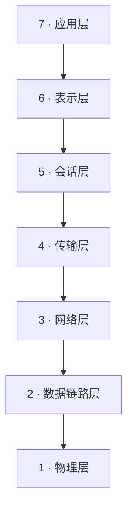

我用 OSI 七层模型理解网络通信是怎么分工的。图里从上到下是发送端封装数据的方向。接收端从物理层往上逐层解析。

## 7. 应用层

我在这一层看程序之间怎么约定消息格式和含义。

[阅读应用层专题](/posts/network-application/)

## 6. 表示层

我在这一层看双方用什么格式表示和读取数据。

[阅读表示层专题](/posts/network-presentation/)

## 5. 会话层

我在这一层看一次持续的交流怎样开始、继续和结束。

[阅读会话层专题](/posts/network-session/)

## 4. 传输层

我在这一层看 TCP 和 UDP 怎样传数据，以及程序如何用套接字收发。

[阅读传输层专题](/posts/network-transport/)

## 3. 网络层

我在这一层看源 IP、目的 IP 和下一跳。

[阅读网络层专题](/posts/network-ip/)

## 2. 数据链路层

我在这一层看一帧怎样送过当前这一跳。

[阅读数据链路层专题](/posts/network-link/)

## 1. 物理层

我在这一层看比特怎样经过网线、光纤或无线传输。

[阅读物理层专题](/posts/network-physical/)

## 串起来看

- [一次 UDP 通信的完整过程](/posts/network-flow/)
- [知识点卡片和关键词索引](/posts/network-keywords/)
